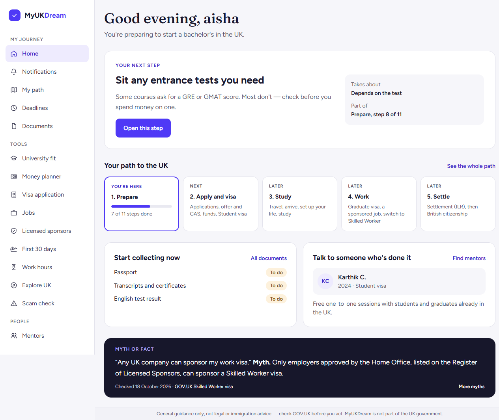

# Bug report — TC-22 lowercase first-name capitalization

**ID:** SCRUM-84-TC-22  
**Title:** Home greeting does not capitalize a lowercase first name  
**Severity:** Low  
**Status:** Reproduced  
**Environment:** `https://app.myukdream.com`, Chromium

## Steps to reproduce

1. Sign in as a student.
2. Open Profile and settings.
3. Set the full name to `aisha teststudent` and save.
4. Open Home.

## Expected

The greeting capitalizes the first letter: `Good evening, Aisha` (time-appropriate greeting).

## Actual

The greeting uses the registered lowercase spelling: `Good evening, aisha`.

## Evidence

## Notes

The behavior was reproduced in the browser. The temporary test name was restored to the account's original profile value after capturing the screenshot.
